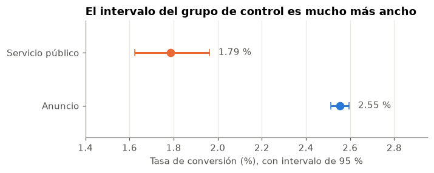
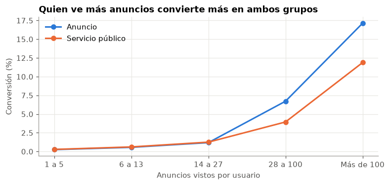

# Medición del impacto de campañas con experimentos A/B

¿Mostrar publicidad comercial aumenta la conversión frente a un anuncio de servicio público? Este proyecto audita el experimento, estima el efecto con varios métodos y lo traduce en una decisión económica.

**Notebook principal:** [nb_01_experimento_ab.ipynb](nb_01_experimento_ab.ipynb)

## Resultado

**El anuncio aumenta la conversión en 0.769 puntos porcentuales** (IC 95 %: 0.595 a 0.943), un aumento relativo de 43.1 %.

| Grupo | Usuarios | Conversión |
|---|---|---|
| Publicidad comercial | 564,577 | 2.555 % |
| Anuncio de servicio público | 23,524 | 1.785 % |

**Valor económico** con un margen ilustrativo de 50 por conversión:

| Costo por 1,000 usuarios | Beneficio esperado | IC 95 % | Probabilidad de ganar |
|---|---|---|---|
| 100 | +285 | +198 a +372 | 100.0 % |
| 200 | +185 | +98 a +272 | 100.0 % |
| 300 | +85 | −2 a +172 | 96.6 % |
| 400 | −15 | −102 a +72 | 35.3 % |
| 500 | −115 | −202 a −28 | 0.3 % |

El punto de equilibrio es cercano a 385 por cada 1,000 usuarios.

## Qué se concluye

- **El resultado es consistente.** La prueba z, Fisher, permutación, bootstrap y el análisis bayesiano llevan a la misma conclusión. Una prueba A/A da 5.30 % de falsos positivos, cerca del 5 % esperado.
- **Ajustar no cambia el efecto.** El odds ratio se mantiene entre 1.44 y 1.48 al ajustar por día, hora y anuncios vistos.
- **Los grupos se parecen, con una señal menor.** La mayor diferencia estandarizada es 0.072, por debajo de la referencia de 0.10.
- **El efecto aparece con exposición alta.** Es casi cero hasta 27 anuncios y llega a +5.25 pp con más de 100. Es una variable posterior a la asignación, así que solo sugiere una hipótesis para un nuevo experimento.





## Metodología

1. **Auditoría.** Unicidad de usuarios, valores válidos y reparto entre grupos.
2. **Balance.** Diferencias estandarizadas entre grupos, además de valores p.
3. **Efecto principal.** Diferencia de proporciones, intervalos de Wald y Newcombe, y efecto relativo.
4. **Comprobaciones.** Fisher, permutación, bootstrap, análisis bayesiano y prueba A/A.
5. **Ajustes y sesgo.** Regresión logística, Mantel-Haenszel y valor E.
6. **Subgrupos exploratorios.** Comparaciones por día, franja y exposición, con corrección de Holm.
7. **Potencia.** Efecto mínimo detectable y tamaño de muestra según el reparto.
8. **Decisión económica.** Beneficio neto, punto de equilibrio y probabilidad de ganar.

## Datos

Se usa `marketing_AB.csv` del conjunto **Marketing A/B Testing**, con 588,101 usuarios. Los datos no se incluyen en este repositorio.

**Descarga:** [Kaggle: Marketing A/B Testing](https://www.kaggle.com/datasets/faviovaz/marketing-ab-testing). Es posible que debas iniciar sesión en Kaggle.

Copia el archivo descargado a la carpeta `data/` de este proyecto, con el nombre `marketing_AB.csv.zip` o `marketing_AB.csv`.

## Cómo ejecutarlo

Probado con Python 3.14. Dentro de `ad-conversion-ab-test`:

```powershell
python -m venv venv_ad-conversion-ab-test
.\venv_ad-conversion-ab-test\Scripts\python.exe -m pip install -r requirements_ad-conversion-ab-test.txt
```

Abre el notebook, selecciona ese entorno como kernel y ejecuta todas las celdas. Con `SEMILLA = 11` se reproducen los resultados de este documento.

## Estructura

```
ad-conversion-ab-test/
├── nb_01_experimento_ab.ipynb            Análisis completo
├── requirements_ad-conversion-ab-test.txt Dependencias con versiones exactas
├── img/                                  Gráficos de este documento
└── data/                                 Coloca aquí el archivo (no se versiona)
```

## Tecnologías

Python, pandas, NumPy, SciPy, statsmodels y Matplotlib.

## Limitaciones

- **Sin protocolo del experimento.** No se conoce la forma de asignación ni el reparto planificado.
- **El control ve otro anuncio.** El efecto es frente a un anuncio de servicio público, no frente a no mostrar nada.
- **Sin fechas ni ventana de conversión.** No se puede saber si el efecto dura.
- **Sin variables previas al experimento.** El balance solo se revisa con variables medidas después.
- **Economía ilustrativa.** El archivo no trae costos ni márgenes.
- **Caso publicitario general.** No se puede extrapolar a productos bancarios.

## Fuente de los datos

Vázquez, F. *Marketing A/B Testing* [conjunto de datos]. Kaggle. https://www.kaggle.com/datasets/faviovaz/marketing-ab-testing
