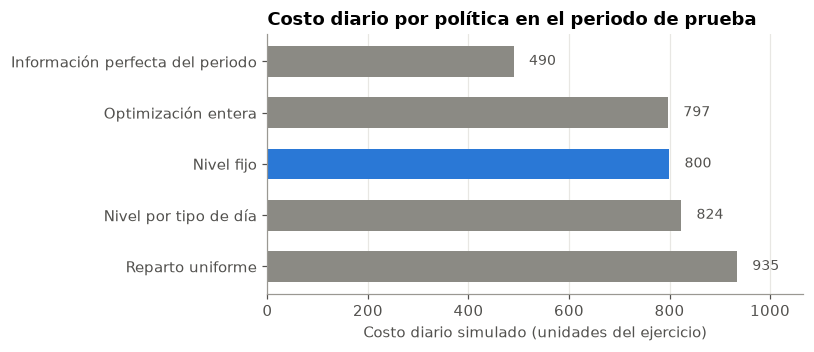
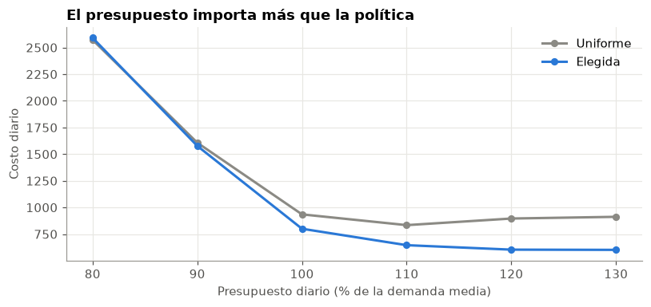

# Reposición de efectivo en cajeros automáticos

¿Cuánto efectivo debe cargar un banco en cada cajero con un presupuesto limitado? Este proyecto compara reglas simples y optimización entera, simulando el inventario día a día sin usar información futura.

> **Datos sintéticos.** Los resultados demuestran un método de decisión y no representan a un banco real.

**Notebook principal:** [nb_01_optimizacion_cajeros.ipynb](nb_01_optimizacion_cajeros.ipynb)

## Resultado

**Una regla simple de nivel fijo ahorra 14.4 % frente al reparto uniforme y empata con la optimización entera.** La política lleva cada cajero a un nivel objetivo de entre 23,000 y 24,000.

| Política | Costo diario en prueba | Servicio |
|---|---|---|
| **Nivel fijo (elegida)** | **800** | 97.0 % |
| Optimización entera | 797 | 96.8 % |
| Nivel por tipo de día | 824 | 96.6 % |
| Reparto uniforme | 935 | 97.0 % |
| Información perfecta (referencia) | 490 | 98.3 % |

El servicio es el porcentaje de retiros atendidos. Los costos usan valores ilustrativos de faltante, saldo inmovilizado y visita.

## Qué se concluye

- **Hay poco que anticipar.** Saber si el día es laborable explica cerca del 10 % de la variación, y lo ocurrido ayer casi no aporta.
- **La optimización no supera a la regla simple.** La diferencia es de 2 por día, con un intervalo de −51 a +47.
- **Pocos datos empeoran la decisión.** Con los últimos 8 días, la optimización cuesta 798 en validación. Con 120 días, 707.
- **El presupuesto es la palanca principal.** Subirlo de 100 % a 110 % de la demanda media baja el costo de 800 a 646. Con 80 %, ninguna política marca diferencia.
- **Un dato muy predictivo puede ser inútil.** `Location` explica 32.5 % de la variación, pero cambia sin explicación para un mismo cajero.





## Metodología

1. **Calidad y señal.** Revisión del panel y de qué variables se conocen al decidir.
2. **Pronóstico.** Comparación de medias, reglas de calendario, regresión y boosting.
3. **Políticas.** Reparto uniforme, nivel fijo, nivel por tipo de día y optimización entera con escenarios.
4. **Simulación.** Inventario que se arrastra entre días, con presupuesto y capacidad.
5. **Selección.** Regla definida de antemano sobre un periodo de validación.
6. **Prueba final.** Últimos 92 días, con intervalos por bootstrap de bloques semanales.
7. **Sensibilidad.** Presupuesto, costos, capacidad, reciclaje de depósitos y valor de la información.
8. **Comprobación.** El optimizador se contrasta con programación dinámica.

## Datos

Se usa `synthetic_atm_cash_data.csv`, con retiros y depósitos diarios sintéticos de 5 cajeros durante 2023.

Coloca el archivo en la carpeta `data/` de este proyecto.

## Cómo ejecutarlo

Probado con Python 3.14. Dentro de `atm-cash-replenishment-optimization`:

```powershell
python -m venv venv_atm-cash-replenishment-optimization
.\venv_atm-cash-replenishment-optimization\Scripts\python.exe -m pip install -r requirements_atm-cash-replenishment-optimization.txt
```

Abre el notebook, selecciona ese entorno como kernel y ejecuta todas las celdas. La ejecución tarda unos 3 minutos. Con `SEMILLA = 7` se reproducen los resultados de este documento.

## Estructura

```
atm-cash-replenishment-optimization/
├── nb_01_optimizacion_cajeros.ipynb                    Análisis completo
├── requirements_atm-cash-replenishment-optimization.txt Dependencias con versiones exactas
├── img/                                                Gráficos de este documento
└── data/                                               Coloca aquí el CSV (no se versiona)
```

## Tecnologías

Python, pandas, NumPy, SciPy, scikit-learn y Matplotlib.

## Limitaciones

- **Datos sintéticos.** No representan a un banco real.
- **Supuestos operativos.** Capacidad, saldo inicial y costos no vienen en los datos.
- **Demanda completa.** Se asume que los retiros registrados incluyen toda la demanda.
- **Sin rutas ni horarios.** Cada cajero se puede abastecer cada mañana.
- **Horizonte corto.** Un año de datos y solo 3 feriados.
- **Decisión de un día.** La optimización no planifica varios días adelante.
