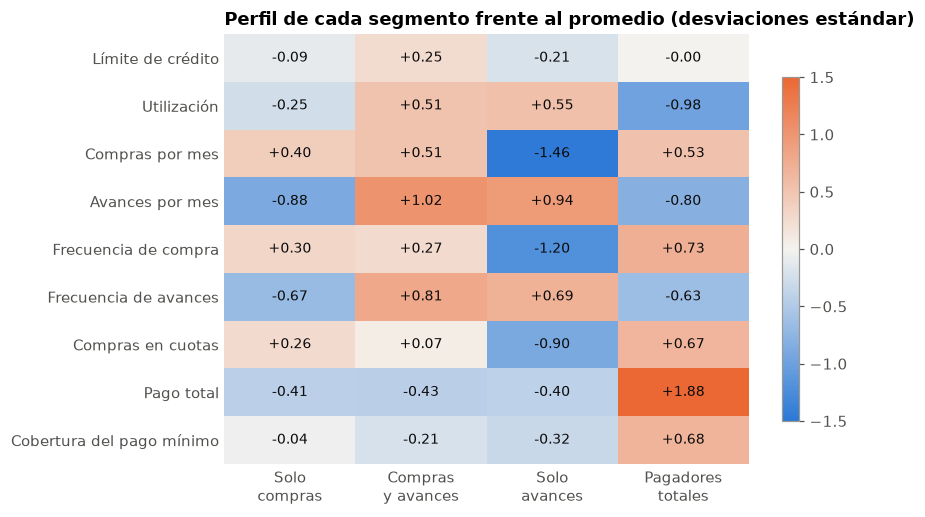
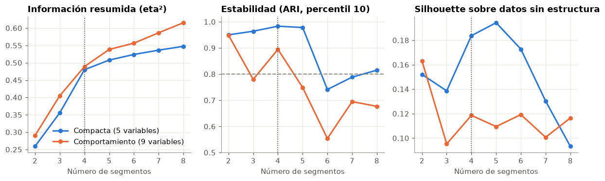

# Segmentación conductual de tarjetas de crédito

¿Qué grupos de clientes de tarjeta existen, son estables y justifican acciones comerciales distintas? Este proyecto compara algoritmos, conjuntos de variables y número de segmentos con criterios explícitos, y reta al modelo contra una regla simple.

**Notebook principal:** [nb_01_segmentacion_tarjetas.ipynb](nb_01_segmentacion_tarjetas.ipynb)

## Resultado

**Hay cuatro segmentos útiles y estables,** y cuatro reglas simples los reproducen en 96.9 % de los clientes de prueba.

| Segmento | Clientes | Regla operativa | Comportamiento | Hipótesis para un piloto |
|---|---|---|---|---|
| **Solo compras** | 38.6 % | `CASH_ADVANCE` ≤ 18.5 y `PRC_FULL_PAYMENT` ≤ 0.3 | Compran, no usan avances y casi nunca pagan el total | Compras en cuotas o productos complementarios |
| **Compras y avances** | 23.3 % | `CASH_ADVANCE` > 18.5 y `PURCHASES` > 66.2 | Mayor saldo y límite; compran y retiran efectivo | Revisión de riesgo y educación financiera |
| **Solo avances** | 22.3 % | `CASH_ADVANCE` > 18.5 y `PURCHASES` ≤ 66.2 | No compran; usan la tarjeta como fuente de efectivo | Activar compras o una alternativa de liquidez |
| **Pagadores totales** | 15.8 % | `CASH_ADVANCE` ≤ 18.5 y `PRC_FULL_PAYMENT` > 0.3 | Compran con frecuencia y pagan todo | Beneficios para fidelizar |

**Comparación en clientes de prueba**

| Segmentación | Grupos | Información resumida (eta², IC 95 %) |
|---|---|---|
| **Elegida:** k-means con 5 variables | 4 | **0.463** (0.452 a 0.476) |
| K-means con 9 variables de comportamiento | 4 | 0.474 (0.463 a 0.488) |
| Regla simple de actividad | 4 | 0.446 (0.433 a 0.460) |
| Dos segmentos con las mismas variables | 2 | 0.264 (0.248 a 0.279) |

Eta² indica qué parte de la variación de ocho medidas de negocio explican los segmentos.

## Qué se concluye

- **El número de grupos no debe elegirse con una sola métrica.** Por eso se combinan tamaño, estabilidad, comparación con datos sin estructura e información resumida.
- **Cuatro grupos son el punto de equilibrio.** Pasar de 3 a 4 suma 0.131 de eta², y de 4 a 5 solo 0.019.
- **Una regla simple casi empata con el modelo.** La ventaja de k-means es de 0.017, así que se recomienda operar con reglas y usar el modelo para revisarlas.
- **Los segmentos son estables.** Con otras semillas la asignación no cambia, y Ward coincide casi por completo (ARI de 0.980).
- **Hay señal real, pero depende de la preparación.** La silhouette es 0.416, frente a 0.252 en datos sin estructura. Sin logaritmo, la segmentación cambia por completo (ARI de 0.236).





## Metodología

1. **Calidad de datos.** Auditoría del archivo completo, con un tratamiento para cada hallazgo.
2. **Variables y partición.** Tres conjuntos de variables y separación en entrenamiento, validación y prueba.
3. **Búsqueda.** K-means, Ward y mezcla gaussiana, de 2 a 8 segmentos.
4. **Evaluación.** Silhouette contra datos sin estructura, estabilidad por remuestreo, tamaño mínimo y eta².
5. **Regla de decisión.** Elegibilidad, número de grupos y preferencia por la opción más simple.
6. **Prueba final.** Comparación contra una regla simple y contra alternativas, con intervalos por bootstrap.
7. **Perfiles y validación.** Revisión de variables que el modelo no usó.
8. **Sensibilidad.** Semillas, tamaño de muestra, variables, preparación, algoritmos y densidad.
9. **Uso en la gestión.** Reglas operativas, dimensionamiento de un piloto, ficha y monitoreo.

## Datos

Se usa `CC GENERAL.csv` del conjunto **Credit Card Dataset for Clustering**, con 8,950 titulares de tarjeta y 18 variables. Los datos no se incluyen en este repositorio.

**Descarga:** [Kaggle: Credit Card Dataset for Clustering](https://www.kaggle.com/datasets/arjunbhasin2013/ccdata). Es posible que debas iniciar sesión en Kaggle.

1. Descarga el conjunto de datos y descomprímelo.
2. Copia `CC GENERAL.csv` a la carpeta `data/` de este proyecto, sin cambiar su nombre.

## Cómo ejecutarlo

Probado con Python 3.14. Dentro de `credit-card-customer-segmentation`:

```powershell
python -m venv venv_credit-card-customer-segmentation
.\venv_credit-card-customer-segmentation\Scripts\python.exe -m pip install -r requirements_credit-card-customer-segmentation.txt
```

Abre el notebook, selecciona ese entorno como kernel y ejecuta todas las celdas. La ejecución tarda unos 4 minutos. Con `SEMILLA = 51` se reproducen los resultados de este documento.

## Estructura

```
credit-card-customer-segmentation/
├── nb_01_segmentacion_tarjetas.ipynb                  Análisis completo
├── requirements_credit-card-customer-segmentation.txt Dependencias con versiones exactas
├── img/                                               Gráficos de este documento
└── data/                                              Coloca aquí el CSV (no se versiona)
```

## Tecnologías

Python, pandas, NumPy, scikit-learn y Matplotlib.

## Limitaciones

- **Sin dimensión temporal.** Hay una sola foto por cliente, y no se puede medir si los segmentos persisten.
- **Sin resultado de negocio.** No hay rentabilidad, mora ni respuesta a campañas.
- **Sin variables demográficas.** No se puede evaluar si el resultado afecta de forma desigual a ciertos grupos.
- **Acciones no probadas.** Son hipótesis. Con un grupo de control, esta base solo detectaría efectos de 2.1 a 3.1 puntos, suponiendo una respuesta base de 5 %.
- **Sensibilidad a la preparación.** Cambiar la escala o el logaritmo modifica los segmentos.
- **Diseño no totalmente ciego.** La regla de decisión se definió tras ver los resultados de validación.
