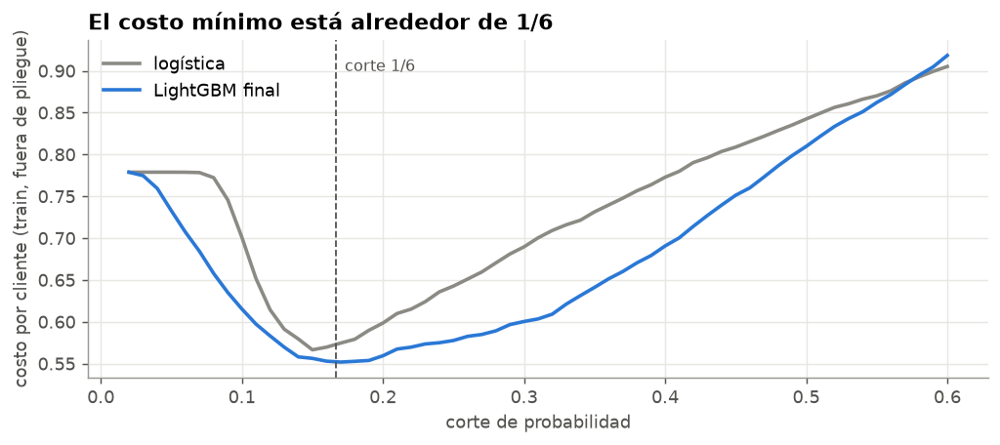
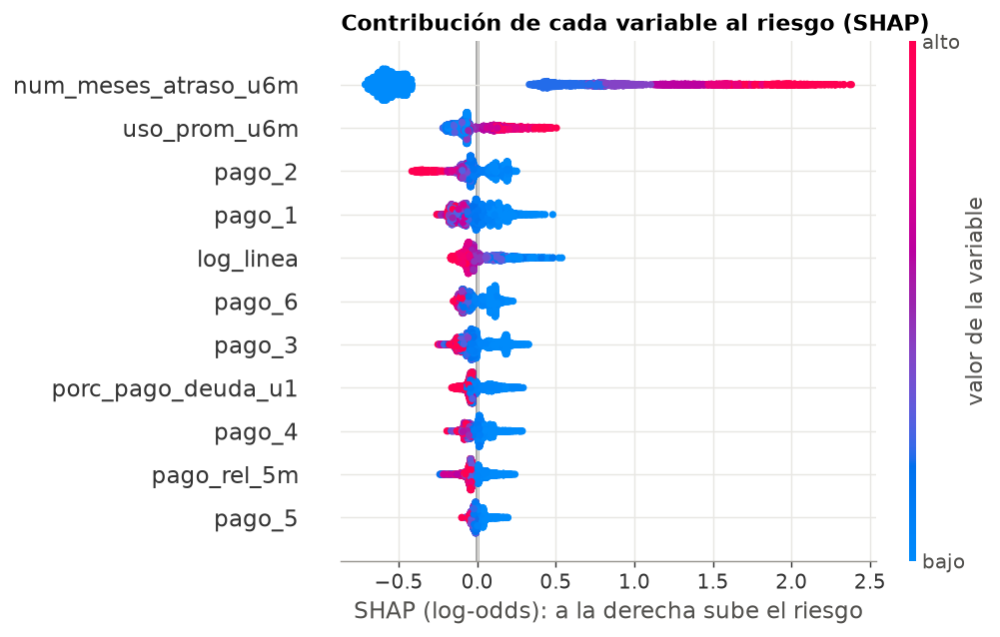

# Impago en tarjetas de crédito: a quién reducir la línea

¿A qué clientes reducir la línea de crédito si no detectar un impago cuesta 5 veces más que reducírsela por error a un buen cliente? Este proyecto construye un modelo de probabilidad de impago a un mes, lo compara con una logística y con una regla de atraso, y traduce el corte de costos a clientes, impagos y montos de línea.

**Notebook principal:** [nb_01_impago_tarjetas_reduccion_lineas.ipynb](nb_01_impago_tarjetas_reduccion_lineas.ipynb)

## Resultado

**Reducir la línea a quien tenga una probabilidad de impago mayor a 1/6, según un LightGBM con restricciones monotónicas.** En los 9,000 clientes de prueba, es la alternativa de menor costo:

| Alternativa | Clientes reducidos | Impagos anticipados | Buenos clientes afectados | Costo por cliente | Ahorro frente a no actuar |
|---|---|---|---|---|---|
| No reducir a nadie | 0 % | 0 % | 0 % | 1.106 | — |
| Reducir a todos | 100 % | 100 % | 100 % | 0.779 | 29.6 % |
| Regla: tuvo algún atraso | 33.1 % | 62.8 % | 24.7 % | 0.604 | 45.4 % |
| Logística (p > 1/6) | 42.5 % | 70.5 % | 34.6 % | 0.596 | 46.1 % |
| **LightGBM (p > 1/6)** | **44.9 %** | **74.4 %** | **36.6 %** | **0.567** | **48.7 %** |

El costo suma 5 por cada impago no detectado y 1 por cada buen cliente al que se le reduce la línea, dividido entre el número de clientes.

**Comparación de modelos en prueba**

| Métrica | Logística | LightGBM | Diferencia (IC 95 % pareado) |
|---|---|---|---|
| Gini | 0.499 | **0.527** | +0.028 (0.019 a 0.037) |
| KS | 0.376 | **0.400** | +0.024 (0.013 a 0.037) |
| PR AUC | 0.489 | **0.504** | +0.014 (0.008 a 0.021) |
| Brier | 0.146 | **0.142** | −0.004 (−0.005 a −0.003) |
| Costo por cliente al corte de 1/6 | 0.596 | **0.567** | −0.028 (−0.043 a −0.014) |

## Qué se concluye

- **El corte sale de los costos, no de una métrica.** Reducir conviene cuando 5 × p > 1 × (1 − p), es decir, cuando p > 1/6. La curva de costo fuera de pliegue tiene su mínimo en 0.17, prácticamente el mismo valor.
- **El corte solo funciona porque el modelo está calibrado.** La probabilidad media en prueba es igual a la tasa de impago (22.1 %), y en 9 de 10 deciles el desvío es de 0.7 puntos o menos. La logística llegaba a 5.4 puntos de desvío, justo alrededor del corte.
- **El modelo aporta más que una regla de atraso.** El atraso explica el 47.7 % de la importancia SHAP, pero el modelo supera a la regla en Gini por 0.090 y ordena dentro de cada grupo de atraso: Gini de 0.278 entre los clientes sin ningún mes con atraso, donde la regla no distingue a nadie.
- **Cada reducción adicional frente a la regla paga su costo.** El modelo reduce la línea a 1,065 clientes más, de los cuales el 21.8 % cae en impago, por encima del 16.7 % que hace rentable reducir.
- **Las 11 variables mueven el riesgo en el sentido esperado.** Sin restricciones, los modelos de árboles tenían tramos en contra del negocio en casi todos los clientes (por ejemplo, pagar más subía el riesgo). Con restricciones monotónicas no queda ninguno, y el Gini de LightGBM baja apenas de 0.550 a 0.547.
- **Se usa un solo corte para toda la cartera.** La acción es binaria y el costo es el mismo para todos los clientes, así que un corte por segmento solo podría igualar el costo o empeorarlo.
- **El precio es comercial:** se afecta al 36.6 % de los buenos clientes y al 25.6 % de su línea, para alcanzar el 65.9 % de la línea de los clientes que caen en impago.





## Metodología

1. **Calidad de datos.** Duplicados, códigos sin documentar en educación, estado civil y estado de pago, y un cambio de codificación del atraso en septiembre.
2. **Variables.** 16 variables derivadas de atraso (recencia, frecuencia y magnitud), uso, pago y línea. Sexo, edad, estado civil y educación quedan fuera de la decisión.
3. **Partición.** Prueba estratificada de 30 % que se usa una sola vez, y validación cruzada de 5 pliegues en entrenamiento para todas las decisiones.
4. **Selección de variables.** De 35 candidatas quedan 11, con filtro univariado, estabilidad (PSI), IV y Gini por pliegue, correlación y VIF.
5. **Modelo de referencia.** Regresión logística depurada a 7 variables, con revisión de coeficientes, métricas y calibración.
6. **Aprendizaje automático.** Comparación de LightGBM, XGBoost, Random Forest y Extra Trees con FLAML, con los mismos pliegues y el mismo presupuesto.
7. **Sentido económico.** SHAP, prueba de monotonía por cliente con curvas ICE y restricciones monotónicas.
8. **Ajuste fino.** Optuna sobre LightGBM, partiendo de la configuración de FLAML.
9. **Elección.** Regla fijada de antemano: el modelo reemplaza a la logística solo si mejora el Gini y el costo con intervalos pareados que excluyen el cero.
10. **Frente a la regla de atraso.** Métricas, Gini dentro de cada grupo de atraso y cruce de decisiones.
11. **Prueba y estrategia.** Evaluación única en prueba, curva de costo y comparación de alternativas para el negocio.

## Datos

Se usa **Default of Credit Card Clients** (UCI Machine Learning Repository): 30,000 clientes de tarjeta de Taiwán, con la línea, datos demográficos y seis meses de historia (abril a septiembre de 2005) de estado de pago, saldo y pago. El objetivo es el impago de octubre de 2005.

**Descarga:** el notebook descarga el archivo automáticamente la primera vez y lo guarda en `data/`. También se puede descargar a mano desde [UCI: Default of Credit Card Clients](https://archive.ics.uci.edu/dataset/350/default+of+credit+card+clients) y copiar `default of credit card clients.xls` a la carpeta `data/`, sin cambiar su nombre.

## Cómo ejecutarlo

Probado con Python 3.14. Dentro de `credit-card-default-line-reduction`:

```powershell
python -m venv venv-credit-card-default-line-reduction
.\venv-credit-card-default-line-reduction\Scripts\python.exe -m pip install -r requirements_credit-card-default-line-reduction.txt
```

Abre el notebook, selecciona ese entorno como kernel y ejecuta todas las celdas. Con `SEMILLA = 42` se reproducen los resultados de este documento.

## Estructura

```
credit-card-default-line-reduction/
├── nb_01_impago_tarjetas_reduccion_lineas.ipynb        Análisis completo
├── requirements_credit-card-default-line-reduction.txt Dependencias con versiones exactas
├── bitacora_uso_ia.md                                  Registro del uso de IA en el proyecto
├── img/                                                Gráficos de este documento
└── data/                                               Datos descargados (no se versionan)
```

## Tecnologías

Python, pandas, NumPy, scikit-learn, LightGBM, XGBoost, FLAML, Optuna, SHAP, SciPy y Matplotlib.

## Limitaciones

- **Sin prueba fuera de tiempo.** El impago existe para un solo mes y todos los clientes se observan en la misma fecha. La prueba mide si el modelo generaliza a otros clientes, no a otro período.
- **Un contexto muy particular.** Los datos son de Taiwán en 2005, en plena crisis de deuda de tarjetas, con una tasa de impago de 22.1 %.
- **No se mide el efecto de reducir la línea.** No hay datos de intervención: no se sabe si reducir evita el impago, lo adelanta o hace que buenos clientes se vayan. La estrategia supone que la acción no cambia el comportamiento.
- **Costos supuestos.** La relación 5 a 1 es un supuesto de negocio. No hay exposición, severidad ni rentabilidad por cliente para medir los costos en montos.
- **Dependencia del registro del atraso.** El atraso concentra el 47.7 % de la importancia SHAP, por encima del tope de referencia de 30 %. Es una excepción documentada, y la codificación del atraso es lo primero que hay que vigilar.
- **Equidad no evaluada.** Las variables protegidas no se usan para decidir, pero no se midió si la decisión afecta de forma distinta a cada grupo.
- **Horizonte de un mes.** No es una PD a 12 meses como la que piden normalmente la regulación o las provisiones.
