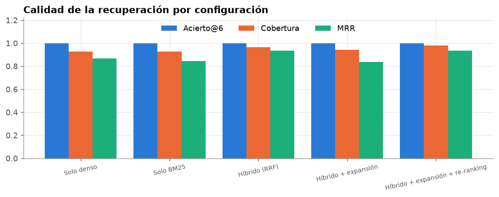
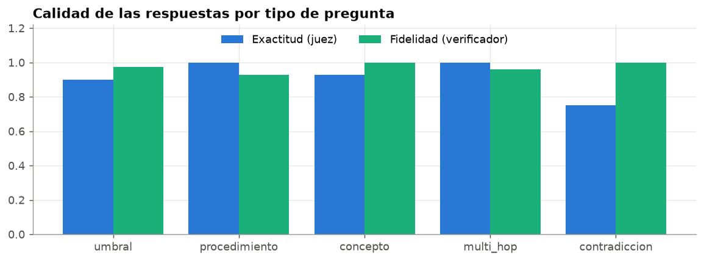
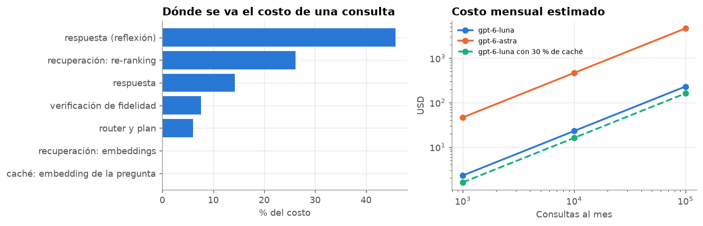

# Asistente de consulta de guías de modelos de riesgo de crédito

Quien desarrolla o valida modelos de riesgo necesita consultar dos guías de 17 páginas con decenas de umbrales. Este proyecto construye un asistente que responde esas preguntas con citas exactas, no inventa criterios, resiste usos indebidos y tiene un costo por consulta conocido. Combina RAG híbrido, guardrails, verificación de fidelidad, caché semántico y revisión humana de las respuestas dudosas.

**Notebook principal:** [nb_01_asistente_consulta_guias.ipynb](nb_01_asistente_consulta_guias.ipynb) · **App:** `streamlit run app.py`

## Resultado

| Medida | Resultado |
|---|---|
| Cobertura de la recuperación (híbrido + expansión + re-ranking) | **0.978** |
| Exactitud de las respuestas (modelo juez, 23 preguntas) | **0.913** |
| Fidelidad de las respuestas (verificador) | **0.982** |
| Abstención en preguntas sin respuesta en las guías | 3 de 3 |
| Ataques resistidos y preguntas legítimas bloqueadas | 12 de 12 y 0 de 26 |
| Costo y tiempo por consulta (mediana) | $0.00125 y 13.4 s |
| Costo total de construir y evaluar el notebook | $0.22 |

**Comparación de técnicas de recuperación** (23 preguntas con secciones esperadas, 6 fragmentos al modelo)

| Configuración | Acierto@6 | Cobertura | MRR |
|---|---|---|---|
| Solo búsqueda densa | 1.000 | 0.928 | 0.866 |
| Solo BM25 | 1.000 | 0.928 | 0.843 |
| Híbrido (RRF) | 1.000 | 0.964 | 0.935 |
| Híbrido + expansión de la consulta | 1.000 | 0.942 | 0.837 |
| **Híbrido + expansión + re-ranking** | **1.000** | **0.978** | **0.935** |

## Qué se concluye

- **Ninguna técnica de búsqueda gana siempre.** BM25 acierta con siglas como *VIF* y la búsqueda densa con paráfrasis; juntas superan a cada una. La expansión de la consulta, sola, **empeora** la cobertura (de 0.964 a 0.942), y el re-ranking la recupera hasta 0.978. El re-ranking es, a la vez, el 81 % del costo de la recuperación.
- **Verificar cada afirmación es barato y necesario.** Al cambiar en una respuesta el umbral de VIF de 5 a 3, el verificador la marca como no respaldada, por $0.0002.
- **El asistente muestra las contradicciones en lugar de esconderlas.** Ante *"¿el corte de PSI es 0.20 o 0.25?"* explica que 0.20 aplica a población, variables y PD en operación, y 0.25 al puntaje en validación.
- **La defensa en capas funciona y no estorba.** Las reglas detienen 5 ataques sin costo, el router detiene 4 y los otros 3 se responden sin obedecer la instrucción inyectada. Ninguna pregunta legítima se bloqueó.
- **El modelo pequeño basta.** `gpt-6-astra` logró la misma fidelidad que `gpt-6-luna` en las preguntas de prueba, a 34 veces el costo. Una sola reflexión con el modelo potente fue el 46 % del costo de toda la evaluación.
**Recomendación:** usarlo como apoyo de consulta, con `gpt-6-luna` en todas las etapas, verificación obligatoria y revisión humana de las respuestas dudosas. Antes de llevarlo a varios usuarios, ampliar el conjunto de evaluación con preguntas reales y mover el índice y el estado a servicios compartidos.







## Arquitectura

```
pregunta
  ├─► Guardrail de entrada ─── reglas: inyección, credenciales, anonimización de datos personales (sin costo)
  ├─► Caché semántico ──────── ¿ya respondimos algo con el mismo significado? (similitud ≥ 0.93)
  ├─► Router y plan ─────────── gpt-6-luna: ¿es una consulta? reformulaciones y subpreguntas
  ├─► Recuperación ──────────── denso + BM25 por consulta → RRF → re-ranking → 6 fragmentos
  ├─► Respuesta ─────────────── citas [n] obligatorias, esquema Pydantic con reintento guiado
  ├─► Verificación ──────────── cada afirmación contra sus fuentes; si falla, reflexión con gpt-6-astra
  ├─► Guardrail de salida ───── copia textual de las guías y credenciales
  └─► Caché y traza ─────────── respuesta aprobada, tokens, costo y latencia por etapa
```

| Concepto | Dónde está |
|---|---|
| Fragmentación semántica con metadatos | `asistente/ingesta.py` |
| Índice híbrido (vectores + BM25) y RRF | `asistente/indice.py` |
| Expansión de la consulta y re-ranking | `asistente/recuperacion.py` |
| Guardrails, verificación de fidelidad y control de copia | `asistente/guardrails.py` |
| Router, multi-hop, contradicciones, reflexión y escalamiento | `asistente/flujo.py` |
| Caché semántico y trazas | `asistente/memoria.py` |
| Registro de tokens, costo y proyección mensual | `asistente/costos.py` |
| Métricas de recuperación, juez, red teaming y falsos positivos | `asistente/evaluacion.py` |

## Metodología

1. **Documentos.** Dos guías en Markdown, que conservan títulos y tablas; el PDF solo se usa si falta la versión Markdown.
2. **Fragmentación semántica.** Por sección y subsección, sin partir tablas ni pasos numerados: 65 fragmentos con guía, etapa, ruta y tipo.
3. **Índice híbrido.** Embeddings de `text-embedding-3-small` con encabezado contextual, y BM25 sobre el mismo texto.
4. **Recuperación.** Consultas múltiples del router, fusión RRF, re-ranking con `gpt-6-luna` y filtro opcional por guía.
5. **Generación controlada.** Esquema Pydantic con citas, validación estructural, verificación de cada afirmación y una reflexión con escalamiento al modelo potente.
6. **Seguridad.** Tres capas (reglas, router y salida), anonimización antes de enviar texto a OpenAI y control de copia textual.
7. **Evaluación.** 26 preguntas con secciones esperadas y respuesta de referencia, en seis tipos: umbrales, procedimientos, conceptos, preguntas compuestas, contradicciones y temas fuera de las guías. A eso se suman 12 ataques y la medición de falsos positivos.
8. **Costos.** Tokens de entrada, salida y razonamiento por llamada, comparación entre modelos y proyección mensual con y sin caché.

## Datos

La base de conocimiento son dos guías técnicas en `knowledge_base/`, en Markdown y en PDF: una de desarrollo e implementación de modelos de riesgo crediticio y otra de validación de modelos de riesgo. Los archivos de evaluación (`evaluacion/`) incluyen las 26 preguntas con sus secciones esperadas y respuestas de referencia, y los 12 ataques del red teaming.

## Cómo ejecutarlo

Probado con Python 3.14. Dentro de `credit-risk-model-review-assistant`:

```powershell
python -m venv venv_credit-risk-model-review-assistant
.\venv_credit-risk-model-review-assistant\Scripts\python.exe -m pip install -r requirements_credit-risk-model-review-assistant.txt
.\venv_credit-risk-model-review-assistant\Scripts\python.exe -m ipykernel install --user --name venv_credit-risk-model-review-assistant
```

Crea un archivo `.env` en esta carpeta o en la raíz del portafolio con tu clave:

```
OPENAI_API_KEY=tu_clave
```

Abre el notebook, selecciona ese entorno como kernel y ejecuta todas las celdas. Las evaluaciones llaman a la API (unos $0.22 la primera vez) y guardan sus resultados en `data/evaluacion/`, así que las siguientes ejecuciones no vuelven a gastar. Para repetirlas, cambia `REEJECUTAR_EVALUACION` a `True`.

Para la consola visual:

```powershell
.\venv_credit-risk-model-review-assistant\Scripts\streamlit.exe run app.py
```

La app tiene tres pestañas:
- **Consulta:** chat con fuentes, verificación, traza y costo por llamada.
- **Evaluación:** resultados del notebook.
- **Observabilidad:** historial de consultas.

## Estructura

```
credit-risk-model-review-assistant/
├── nb_01_asistente_consulta_guias.ipynb                Construcción paso a paso, evaluación y costos
├── app.py                                              Consola visual en Streamlit
├── asistente/                                          Paquete: ingesta, índice, recuperación, guardrails y flujo
├── evaluacion/                                         Preguntas de evaluación y ataques
├── knowledge_base/                                     Guías de desarrollo y validación (.md y .pdf)
├── requirements_credit-risk-model-review-assistant.txt Dependencias con versiones exactas
├── img/                                                Gráficos de este documento
└── data/                                               Índice, caché, trazas y evaluaciones (no se versiona)
```

## Tecnologías

Python, OpenAI (`gpt-6-luna`, `gpt-6-astra` y `text-embedding-3-small`), LangChain, Pydantic, NumPy, rank-bm25, pandas, Matplotlib, Streamlit e ipywidgets.

## Limitaciones

- **Corpus pequeño.** Con 65 fragmentos, la expansión y el re-ranking apenas mejoran sobre el híbrido simple; su valor crece con el corpus.
- **Evaluación acotada.** Las 26 preguntas y los 12 ataques los escribió la misma persona que construyó el sistema, y el juez es el mismo modelo que responde.
- **Resultados no deterministas.** Los modelos de razonamiento no aceptan `temperature = 0`; repetir la evaluación da cifras algo distintas.
- **Reglas que chocan.** La de aclarar cuándo un valor es orientativo y la del verificador estricto convirtieron una respuesta correcta en dudosa.
- **Un solo usuario.** El índice vive en memoria y el estado en archivos. Para varios usuarios haría falta una base vectorial, un almacén de estado compartido y una arquitectura con despachador y trabajadores.
- **Envío a terceros.** Las consultas y los fragmentos se envían a OpenAI, y a LangSmith si se activa `usar_langsmith`.

## Agradecimientos

Gracias a [hlopezo](https://github.com/hlopezo) por compartir las guías de desarrollo y validación de modelos que forman la base de conocimiento de este asistente.
