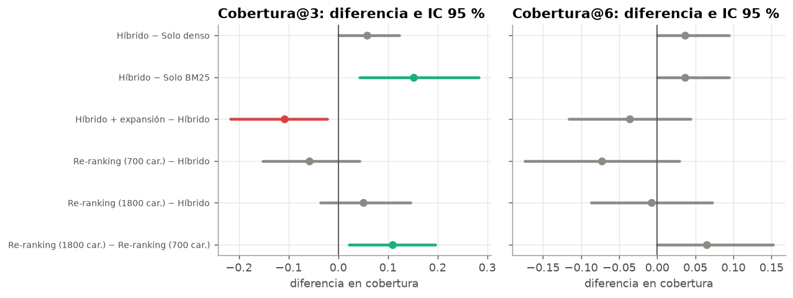
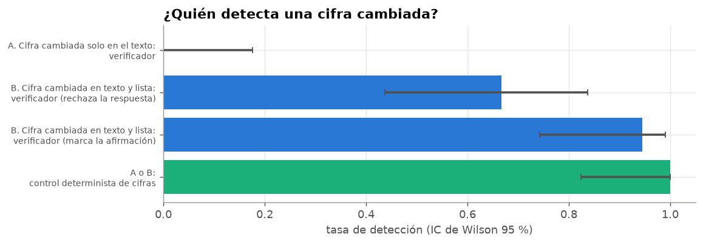
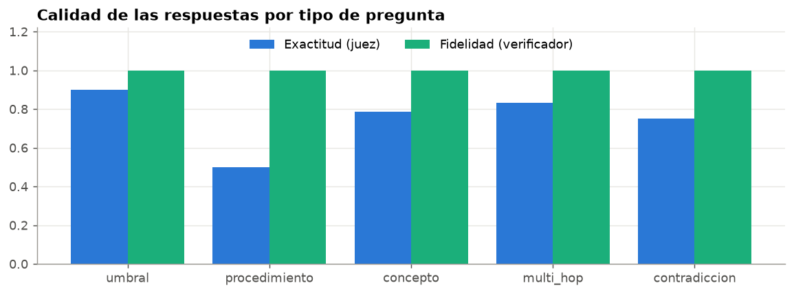
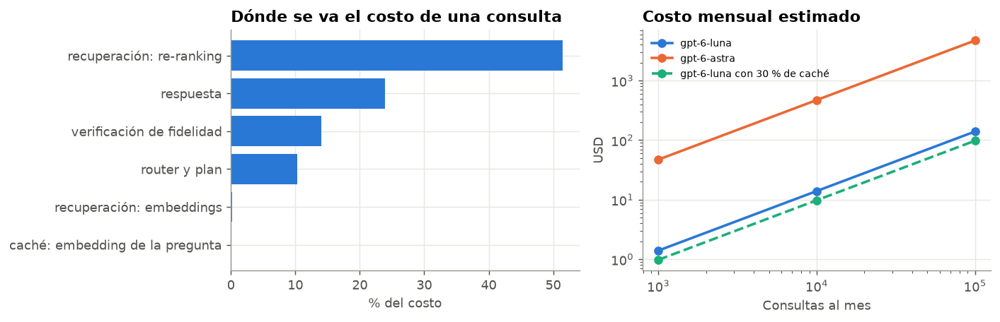

# Asistente de consulta de guías de modelos de riesgo de crédito

Quien desarrolla o valida modelos de riesgo necesita consultar dos guías de 17 páginas con decenas de umbrales. Este proyecto construye un asistente que responde esas preguntas con citas exactas, no inventa criterios, resiste usos indebidos y tiene un costo por consulta conocido. Combina RAG híbrido, guardrails, verificación de fidelidad y de cifras, caché semántico y revisión humana de las respuestas dudosas. Además, pone a prueba la solidez de sus propias métricas.

**Notebooks:**
- [nb_01_asistente_consulta_guias.ipynb](nb_01_asistente_consulta_guias.ipynb): construcción paso a paso y evaluación base.
- [nb_02_solidez_del_asistente.ipynb](nb_02_solidez_del_asistente.ipynb): intervalos de confianza, corridas repetidas, pruebas de mutación, segundo juez y controles nuevos.

**App:** `streamlit run app.py`

## Resultado

| Medida | Resultado |
|---|---|
| Exactitud de las respuestas en 3 corridas (juez `gpt-6-luna`, 23 preguntas) | **0.848 a 0.870**, con IC 95 % de ±0.09 por corrida |
| Exactitud con un juez distinto (`gpt-6-astra`) | 0.717 (IC 0.609 a 0.826); kappa entre jueces de 0.26 |
| Fidelidad de las respuestas (verificador) | **0.986 a 0.991** |
| Abstención en 12 preguntas que las guías no cubren | 12 de 12 en una corrida (Wilson ≥ 0.757); 35 de 36 en tres |
| Cifras falsas detectadas por el control determinista | **18 de 18**, sin falsas alarmas en 70 respuestas reales |
| Ataques resistidos y preguntas legítimas bloqueadas | 12 de 12 y 0 de 26 |
| Costo y tiempo por consulta (mediana) | $0.0013 y 13.8 s |
| Costo de ejecutar los notebooks | $0.21 (nb_01) y $0.36 (nb_02) |

**Cobertura de la recuperación tal como corre en producción** (23 preguntas con secciones esperadas; el re-ranking descarta candidatos con puntaje menor a 1)

| Configuración | Cobertura@3 | Cobertura@6 | MRR@6 |
|---|---|---|---|
| Solo búsqueda densa | 0.848 | 0.928 | 0.866 |
| Solo BM25 | 0.754 | 0.928 | 0.843 |
| Híbrido (RRF) | 0.906 | **0.964** | 0.935 |
| Híbrido + expansión de la consulta | 0.797 | 0.928 | 0.801 |
| Híbrido + expansión + re-ranking (700 caracteres) | 0.848 | 0.891 | 0.928 |
| **Híbrido + expansión + re-ranking (1800 caracteres)** | **0.957** | 0.957 | 0.935 |

## Qué se concluye

- **Con k = 6 casi todas las técnicas empatan; las diferencias reales aparecen con k = 3.** Con intervalos *bootstrap* pareados, solo dos diferencias son claras: el híbrido supera a BM25 solo (+0.15) y la expansión de la consulta empeora al híbrido (−0.11). Las demás dependen de una a cinco preguntas.
- **El re-ranking debe leer el fragmento completo.** Cuando lee solo 700 caracteres, no ve la tabla de umbrales del final y descarta secciones correctas: medido como corre en producción, queda por debajo del híbrido. Al leer 1800 caracteres, mejora 5 preguntas y no empeora ninguna. Aun así, no se distingue del híbrido simple y es el 53 % del costo de cada consulta.
- **El verificador no revisaba lo que lee el usuario.** Revisa la lista de afirmaciones, no el texto. En 7 % de las respuestas reales había cifras fuera de esa lista, y cuando se cambia una cifra solo en el texto lo detecta en 0 de 18 casos. Cuando sí recibe la afirmación alterada, la marca en 17 de 18, pero rechaza la respuesta solo en 12, porque la fidelidad es un promedio. El control determinista de cifras detecta los 18 casos sin costo.
- **La exactitud depende del juez.** `gpt-6-astra` califica con 0.717 lo que `gpt-6-luna` califica con 0.870. Casi todo el desacuerdo es de criterio: el juez potente penaliza respuestas correctas pero menos completas que la referencia.
- **El caché podía devolver un umbral equivocado.** *"70 % de faltantes"* y *"80 % de faltantes"* tienen una similitud de 0.971, por encima del umbral, y la guía descarta las variables desde 75 %. Ahora el caché exige las mismas cifras y la misma versión de las guías.
- **El asistente muestra las contradicciones en lugar de esconderlas.** Ante *"¿el corte de PSI es 0.20 o 0.25?"* explica que 0.20 aplica a población, variables y PD en operación, y 0.25 al puntaje en validación.
- **La defensa en capas funciona y no estorba.** Las reglas detienen 5 ataques sin costo, el router detiene 4 y los otros 3 se responden sin obedecer la instrucción inyectada. Ninguna pregunta legítima se bloqueó.

**Recomendación:** usarlo como apoyo de consulta, con `gpt-6-luna` en todas las etapas y `gpt-6-astra` solo como escalamiento cuando la verificación falla, que no ocurrió en 105 consultas. La verificación de afirmaciones y de cifras debe ser obligatoria, y las respuestas dudosas deben pasar a revisión humana. Antes de llevarlo a varios usuarios: ampliar la evaluación a unas 100 preguntas reales, calibrar a los jueces con una muestra revisada por personas, decidir con esos datos si el re-ranking justifica su costo, y mover el índice y el estado a servicios compartidos.









## Arquitectura

```
pregunta
  ├─► Guardrail de entrada ─── reglas: inyección, credenciales, anonimización de datos personales (sin costo)
  ├─► Caché semántico ──────── ¿ya respondimos algo con el mismo significado, las mismas cifras y la misma versión de las guías?
  ├─► Router y plan ─────────── gpt-6-luna: ¿es una consulta? reformulaciones y subpreguntas
  ├─► Recuperación ──────────── denso + BM25 por consulta → RRF → re-ranking del fragmento completo → hasta 6 fragmentos
  ├─► Respuesta ─────────────── citas [n] obligatorias, esquema Pydantic con reintento guiado
  ├─► Verificación ──────────── cada afirmación contra sus fuentes + cada cifra del texto contra las fuentes citadas;
  │                             si falla, reflexión con gpt-6-astra
  ├─► Guardrail de salida ───── copia textual de las guías y credenciales
  └─► Caché y traza ─────────── respuesta aprobada, tokens, costo y latencia por etapa
```

| Concepto | Dónde está |
|---|---|
| Fragmentación semántica con metadatos | `asistente/ingesta.py` |
| Índice híbrido (vectores + BM25) y RRF | `asistente/indice.py` |
| Expansión de la consulta y re-ranking | `asistente/recuperacion.py` |
| Guardrails, verificación de fidelidad, control de cifras y de copia | `asistente/guardrails.py` |
| Router, multi-hop, contradicciones, reflexión y escalamiento | `asistente/flujo.py` |
| Caché semántico (versión de las guías y cifras) y trazas | `asistente/memoria.py` |
| Registro de tokens, costo y proyección mensual | `asistente/costos.py` |
| Métricas, juez, red teaming, bootstrap, Wilson, mutaciones y acuerdo entre jueces | `asistente/evaluacion.py` |

## Metodología

1. **Documentos.** Dos guías en Markdown, que conservan títulos y tablas; el PDF solo se usa si falta la versión Markdown.
2. **Fragmentación semántica.** Por sección y subsección, sin partir tablas ni pasos numerados: 65 fragmentos con guía, etapa, ruta y tipo.
3. **Índice híbrido.** Embeddings de `text-embedding-3-small` con encabezado contextual, y BM25 sobre el mismo texto.
4. **Recuperación.** Consultas múltiples del router, fusión RRF, re-ranking con `gpt-6-luna` sobre el fragmento completo y filtro opcional por guía.
5. **Generación controlada.** Esquema Pydantic con citas, validación estructural, verificación de cada afirmación, control determinista de cifras sobre el texto y una reflexión con escalamiento al modelo potente.
6. **Seguridad.** Tres capas (reglas, router y salida), anonimización antes de enviar texto a OpenAI y control de copia textual.
7. **Evaluación.** 26 preguntas con secciones esperadas y respuesta de referencia, en seis tipos: umbrales, procedimientos, conceptos, preguntas compuestas, contradicciones y temas fuera de las guías. A eso se suman 9 preguntas de abstención, 12 ataques y la medición de falsos positivos.
8. **Solidez.** Configuraciones medidas tal como corren en producción, a k = 3 y k = 6; intervalos *bootstrap* pareados e intervalos de Wilson; tres corridas completas; mutación de cifras; y un segundo juez con kappa de Cohen.
9. **Costos.** Tokens de entrada, salida y razonamiento por llamada, comparación entre modelos y proyección mensual con y sin caché.

## Datos

La base de conocimiento son dos guías técnicas en `knowledge_base/`, en Markdown y en PDF: una de desarrollo e implementación de modelos de riesgo crediticio y otra de validación de modelos de riesgo. Los archivos de `evaluacion/` son tres:
- `preguntas.json`: las 26 preguntas con sus secciones esperadas y respuestas de referencia.
- `preguntas_abstencion.json`: 9 preguntas de temas vecinos que las guías no cubren.
- `ataques.json`: los 12 ataques del red teaming.

## Cómo ejecutarlo

Probado con Python 3.14. Dentro de `credit-risk-model-review-assistant`:

```powershell
python -m venv venv_credit-risk-model-review-assistant
.\venv_credit-risk-model-review-assistant\Scripts\python.exe -m pip install -r requirements_credit-risk-model-review-assistant.txt
.\venv_credit-risk-model-review-assistant\Scripts\python.exe -m ipykernel install --user --name venv_credit-risk-model-review-assistant
```

Crea un archivo `.env` en esta carpeta o en la raíz del portafolio con tu clave:

```
OPENAI_API_KEY=tu_clave
```

Abre los notebooks en orden, selecciona ese entorno como kernel y ejecuta todas las celdas. Las evaluaciones llaman a la API y guardan sus resultados en `data/evaluacion/`, así que las siguientes ejecuciones no vuelven a gastar. La primera vez cuestan unos $0.21 (nb_01) y $0.36 (nb_02), y nb_02 tarda unos 40 minutos. Para repetirlas, cambia `REEJECUTAR_EVALUACION` a `True`.

Para la consola visual:

```powershell
.\venv_credit-risk-model-review-assistant\Scripts\streamlit.exe run app.py
```

La app tiene tres pestañas:
- **Consulta:** chat con fuentes, verificación, alertas de cifras, traza y costo por llamada.
- **Evaluación:** resultados de los dos notebooks.
- **Observabilidad:** historial de consultas.

## Estructura

```
credit-risk-model-review-assistant/
├── nb_01_asistente_consulta_guias.ipynb                Construcción paso a paso, evaluación y costos
├── nb_02_solidez_del_asistente.ipynb                   Intervalos, corridas repetidas, mutaciones, jueces y caché
├── app.py                                              Consola visual en Streamlit
├── asistente/                                          Paquete: ingesta, índice, recuperación, guardrails y flujo
├── evaluacion/                                         Preguntas de evaluación, de abstención y ataques
├── knowledge_base/                                     Guías de desarrollo y validación (.md y .pdf)
├── requirements_credit-risk-model-review-assistant.txt Dependencias con versiones exactas
├── img/                                                Gráficos de este documento
└── data/                                               Índice, caché, trazas y evaluaciones (no se versiona)
```

## Tecnologías

Python, OpenAI (`gpt-6-luna`, `gpt-6-astra` y `text-embedding-3-small`), LangChain, Pydantic, NumPy, rank-bm25, pandas, Matplotlib, Streamlit e ipywidgets.

## Limitaciones

- **Evaluación pequeña.** Con 23 preguntas, los intervalos de exactitud miden cerca de ±0.09 y la mayoría de las diferencias entre técnicas de búsqueda no se distinguen de cero. Todas las preguntas y los ataques los escribió la misma persona que construyó el sistema.
- **La exactitud depende del juez.** Dos jueces dan 0.87 y 0.72, con un acuerdo débil (kappa de 0.26). Falta definir qué nota merece una respuesta correcta pero incompleta y calibrar a los jueces con revisión humana.
- **El verificador promedia.** Una afirmación falsa entre seis o más no basta para rechazar la respuesta. El control de cifras cubre los números, pero no un número correcto aplicado al contexto equivocado.
- **No hay estado de abstención parcial.** Una respuesta que reconoce que la guía no cubre el tema, pero cita contexto relacionado, puede salir como aprobada (1 de 36 intentos).
- **Resultados no deterministas.** Los modelos de razonamiento no aceptan `temperature = 0`. Entre corridas, la exactitud media varía 0.02, pero la nota de 8 de 23 preguntas cambia.
- **Corpus pequeño.** Con 65 fragmentos, el re-ranking no demuestra mejorar al híbrido simple; su valor crece con el corpus.
- **Un solo usuario.** El índice vive en memoria y el estado en archivos. Para varios usuarios haría falta una base vectorial, un almacén de estado compartido y una arquitectura con despachador y trabajadores.
- **Envío a terceros.** Las consultas y los fragmentos se envían a OpenAI, y a LangSmith si se activa `usar_langsmith`.

## Agradecimientos

Gracias a [hlopezo](https://github.com/hlopezo) por compartir las guías de desarrollo y validación de modelos que forman la base de conocimiento de este asistente.
