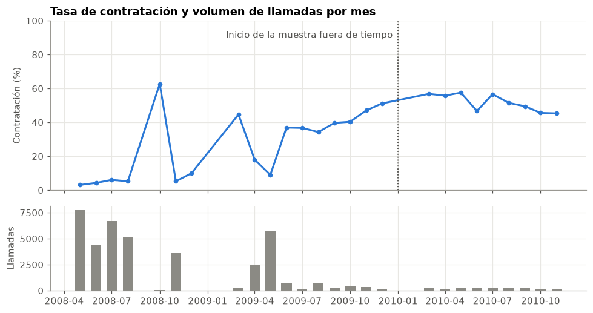
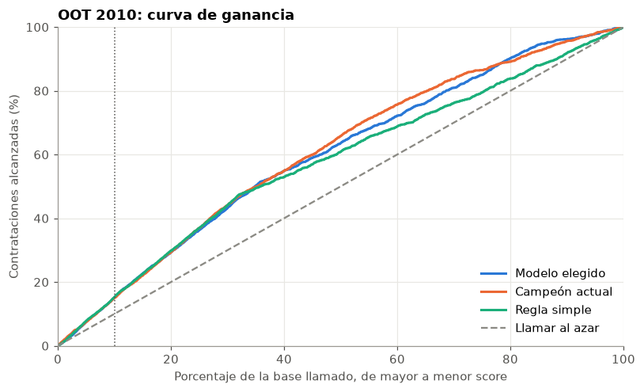

# Propensión a contratar un depósito a plazo

¿A quién debe llamar primero un banco si solo puede contactar al 10 % de su base? Este proyecto compara una regla simple, modelos clásicos, modelos de árboles y AutoML, y elige un modelo pensando en que siga funcionando cuando el contexto cambia.

**Notebook principal:** [nb_01_propension_banca.ipynb](nb_01_propension_banca.ipynb)

## Resultado

**A quién llamar primero.** A las personas que ya fueron contactadas en una campaña previa, comenzando por las que tienen celular.

| Prioridad | Segmento | Personas en 2010 | Contratación observada |
|---|---|---|---|
| 1 | Con contacto previo y celular | 652 | 75.8 % |
| 2 | Con contacto previo y teléfono fijo | 73 | 65.8 % |
| 3 | Sin contacto previo y celular | 1,018 | 46.1 % |
| 4 | Sin contacto previo y teléfono fijo | 315 | 19.7 % |

**Comparación en la prueba final de 2010**

| Modelo | Variables | Gini (IC 95 %) | Contratación con cupo de 10 % |
|---|---|---|---|
| **Elegido:** logística con los últimos 6 meses | 2 | **0.404** (0.362 a 0.443) | 75.6 % |
| Campeón: logística con todo el histórico | 16 | 0.437 (0.392 a 0.481) | 78.0 % |
| Regla: éxito en una campaña previa | 1 | 0.314 (0.278 a 0.351) | 76.6 % |
| Llamar al azar | 0 | 0 | 52.1 % |

El Gini mide qué tan bien ordena un modelo: 0 equivale al azar y 1 a un orden perfecto.

## Qué se concluye

- **El modelo elegido no es el que mejor ordena en 2010.** El campeón lo supera por 0.034 de Gini, y esa diferencia no se explica por azar.
- **Se prefiere por su estabilidad.** Si los indicadores macro llegan con un mes de rezago, el Gini del campeón cae a 0.376 y solo conserva el 27.8 % de su top 10 %. El modelo elegido no usa esos indicadores.
- **La complejidad no mejoró el resultado.** Ningún retador superó al campeón en Gini, incluidos Random Forest, XGBoost, LightGBM y FLAML.
- **Con cupos de hasta 30 %, la regla simple rinde igual.** Con un cupo de 50 %, el modelo obtiene 66.1 % frente a 63.4 % de la regla, porque sigue ordenando cuando se agotan los clientes con éxito previo.

**Recomendación:** usar el modelo de dos variables como base, recalibrar sus probabilidades cada mes y mantener al campeón en paralelo hasta confirmar que los indicadores macro llegan a tiempo.





## Metodología

1. **Calidad de datos.** Revisión de duplicados, valores faltantes y concentración.
2. **Reconstrucción del tiempo.** El archivo no trae el año, así que se deduce a partir de su orden cronológico.
3. **Validación temporal.** El modelo se elige con tres bloques de 2009, entrenando siempre con datos anteriores. Todo 2010 se reserva como prueba final.
4. **Selección de variables.** Filtros de concentración, IV, PSI, correlación, VIF y coherencia de signo, calculados solo con los datos de entrenamiento.
5. **Comparación de 35 configuraciones.** Combina algoritmos, ventanas de entrenamiento y conjuntos de variables, con una regla de elección definida de antemano.
6. **Evaluación final.** Gini, tasa en el cupo y bootstrap pareado para los intervalos de confianza.
7. **Calibración.** Ajuste mensual del nivel de las probabilidades.
8. **Sensibilidad.** Validación aleatoria, longitud de ventana, retiro de variables y estrés de indicadores macro.
9. **Interpretabilidad y equidad.** Tabla de segmentos, odds ratios, SHAP y comparación por edad y estado civil.
10. **Decisión.** Tabla por cupo, ficha del modelo y plan de monitoreo.

`duration` y `campaign` se excluyen porque solo se conocen durante o después de la llamada.

## Datos

Se usa el archivo `bank-additional-full.csv` del conjunto **Bank Marketing**, con 41,188 llamadas de un banco portugués entre mayo de 2008 y noviembre de 2010. Los datos no se incluyen en este repositorio.

**Descarga:** [UCI Machine Learning Repository](https://archive.ics.uci.edu/dataset/222/bank+marketing)

**Opción manual**

1. Descarga el conjunto de datos desde el enlace anterior.
2. Descomprime `bank+marketing.zip` y luego el archivo interno `bank-additional.zip`.
3. Copia `bank-additional/bank-additional-full.csv` a la carpeta `data/` de este proyecto.

**Opción con PowerShell.** Ejecuta esto dentro de `deposit-subscription-propensity`:

```powershell
New-Item -ItemType Directory -Force data | Out-Null
Invoke-WebRequest "https://archive.ics.uci.edu/static/public/222/bank+marketing.zip" -OutFile bank_marketing.zip -UseBasicParsing
Expand-Archive bank_marketing.zip -DestinationPath bank_tmp -Force
Expand-Archive bank_tmp\bank-additional.zip -DestinationPath bank_tmp -Force
Move-Item bank_tmp\bank-additional\bank-additional-full.csv data\ -Force
Remove-Item bank_marketing.zip, bank_tmp -Recurse -Force
```

## Cómo ejecutarlo

Probado con Python 3.14. Dentro de `deposit-subscription-propensity`:

```powershell
python -m venv venv_deposit-subscription-propensity
.\venv_deposit-subscription-propensity\Scripts\python.exe -m pip install -r requirements_deposit-subscription-propensity.txt
```

Abre el notebook, selecciona ese entorno como kernel y ejecuta todas las celdas. Con `SEMILLA = 42` se reproducen los resultados de este documento.

## Estructura

```
deposit-subscription-propensity/
├── nb_01_propension_banca.ipynb                       Análisis completo
├── requirements_deposit-subscription-propensity.txt   Dependencias con versiones exactas
├── img/                                               Gráficos de este documento
└── data/                                              Coloca aquí el CSV (no se versiona)
```

## Tecnologías

Python, pandas, NumPy, scikit-learn, XGBoost, LightGBM, FLAML y Matplotlib.

## Limitaciones

- **Propensión no es efecto causal.** El modelo estima quién responde cuando lo llaman, no cuánto cambia la llamada su decisión. Medirlo requiere un grupo de control aleatorio.
- **La prueba de 2010 no es totalmente ciega.** La elección usa solo 2009, pero candidatos y filtros se revisaron después de ver resultados de ese año.
- **Muestra limitada.** La prueba final tiene 2,058 llamadas, y con un cupo de 10 % son solo 205.
- **Población seleccionada.** Solo se observa a quienes el banco decidió llamar, en un período de crisis financiera.
- **Baja granularidad.** El modelo tiene cuatro segmentos, y en el más bajo la probabilidad recalibrada sobrestima lo observado (36.5 % frente a 19.7 %).
- **Valores ilustrativos.** El costo de llamada y el margen por contratación no provienen del banco.

## Fuente de los datos

Moro, S., Rita, P. y Cortez, P. (2014). *Bank Marketing* [conjunto de datos]. UCI Machine Learning Repository. https://doi.org/10.24432/C5K306

Moro, S., Cortez, P. y Rita, P. (2014). A data-driven approach to predict the success of bank telemarketing. *Decision Support Systems, 62*, 22-31. https://doi.org/10.1016/j.dss.2014.03.001
