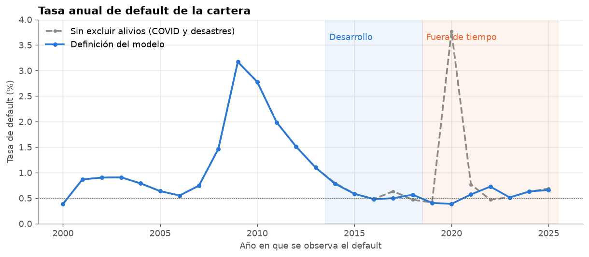
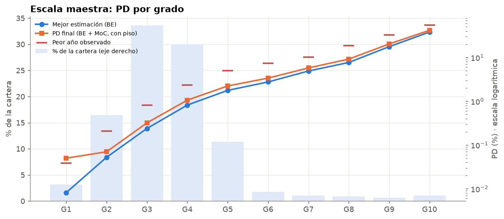
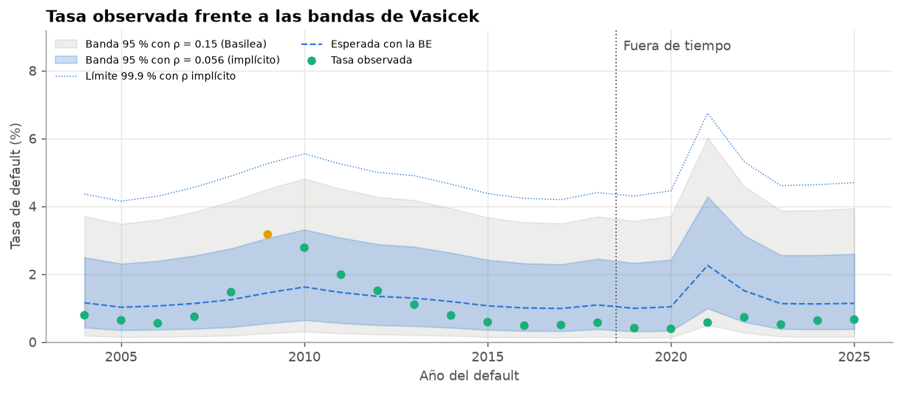
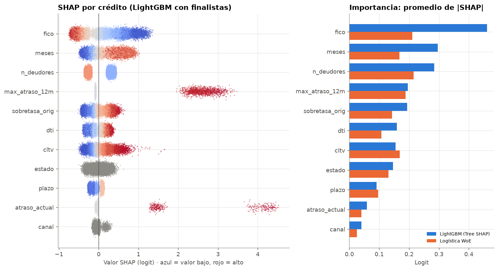

# Probabilidad de default en una cartera hipotecaria de bajo incumplimiento

En una cartera hipotecaria incumple cerca del 0.5 % de los créditos cada año. ¿Cómo se asigna a cada crédito una probabilidad de default (PD) que ordene bien el riesgo y que no lo subestime cuando llegue un año malo? Este proyecto construye una PD de comportamiento a un año con 26 años de historia de Freddie Mac, la calibra al ciclo con las técnicas propias de carteras de bajo default y valida la calibración.

**Notebook principal:** [nb_01_pd_hipotecas_bajo_default.ipynb](nb_01_pd_hipotecas_bajo_default.ipynb). Explica cada método paso a paso: teoría, ejemplo mínimo con datos de juguete, errores comunes y aplicación a los datos.

## Resultado

**Qué PD asignamos.** Cada crédito recibe la PD de su grado en una escala maestra de 10 grados. Una regresión logística con 11 variables ordena el riesgo, la calibración al ciclo 2004–2018 fija el nivel, y un margen de conservadurismo cubre la incertidumbre.

| Grado | % del ciclo | Mejor estimación | PD final |
|---|---|---|---|
| G1 | 3.2 % | 0.008 % | 0.050 % (piso) |
| G2 | 16.5 % | 0.052 % | 0.070 % |
| G3 | 33.6 % | 0.239 % | 0.320 % |
| G4 | 30.0 % | 0.816 % | 1.060 % |
| G5 | 11.3 % | 1.770 % | 2.236 % |
| G6 a G10 | 5.4 % | 2.8 % a 38.1 % | 3.4 % a 41.7 % |

**Comparación fuera de tiempo (default observado de 2019 a 2025)**

| Modelo | Variables | Gini (IC 95 %) | PR AUC |
|---|---|---|---|
| **Elegido:** logística con WoE | 11 | **0.776** (0.769 a 0.783) | 0.183 |
| LightGBM con las mismas variables | 11 | 0.787 (0.781 a 0.795) | 0.191 |
| LightGBM con todas las candidatas | 20 | 0.791 (0.785 a 0.798) | 0.197 |
| Regla: peor atraso y FICO | 2 | 0.768 (0.761 a 0.775) | 0.157 |
| Orden al azar | 0 | 0 | 0.0055 |

El Gini mide qué tan bien ordena un modelo: 0 equivale al azar y 1 a un orden perfecto. El PR AUC es el área bajo la curva precisión–recall, estimada con la precisión promedio (*average precision*): resume la precisión al recorrer la lista de mayor a menor riesgo, y su valor al azar es la tasa de default.

## Qué se concluye

- **Lo difícil no es ordenar, sino fijar el nivel.** El modelo ordena con un Gini de 0.78, pero los años del desarrollo (2014–2018) tienen una tasa de 0.57 % y el ciclo, 1.18 %. Sin calibrar, la PD subestimaría una crisis como la de 2009 (3.17 %) por un factor de más de 3.
- **La calibración cambia el capital.** En la cartera de 2024, la PD promedio pasa de 0.56 % sin calibrar a 1.28 % con la PD final, y la densidad de activos ponderados por riesgo, de 12.9 % a 26.1 %.
- **La definición del default pesa más que el algoritmo.** Si se contara como default el atraso durante el *forbearance* del COVID, 2020 parecería peor que 2009 (3.77 %) y el Gini fuera de tiempo caería de 0.78 a 0.51.
- **El atraso durante un alivio no es default, pero es la mejor señal del default que viene.** Excluirlo también de las variables baja el Gini de 2021–2022 de 0.87–0.89 a 0.52–0.55.
- **Cero defaults no significa PD cero.** El mejor grado tuvo 8 defaults en 15 años. Fuera de tiempo, su mejor estimación quedó corta (prueba de Jeffreys en amarillo) y el piso de 0.05 % cubrió la diferencia.
- **Validar una PD de bajo default tiene poca potencia.** Con la correlación de Basilea (ρ = 0.15), la banda de un año es tan ancha que ni 2009 queda fuera. Con la correlación implícita en los datos (0.056), 2009 sale en amarillo y todos los años fuera de tiempo, en verde.

**Recomendación:** usar la logística calibrada al ciclo como modelo base, recalibrar la tendencia central cada año incorporando los años nuevos, y evaluar para la siguiente versión un desarrollo más largo (2010–2017), que mejoró el Gini fuera de tiempo a 0.793.









## Metodología

1. **Cohortes anuales.** La cartera vigente al 31 de diciembre de cada año, de 1999 a 2024, se sigue durante los 12 meses siguientes. Son 5.9 millones de filas crédito-año.
2. **Variable objetivo.** El default es un atraso de 90 días o más, un cierre con pérdida o una reestructura. El atraso durante un *forbearance* o una emergencia por desastre no cuenta. El umbral de 90 días se justifica con tasas de cura y matrices de transición.
3. **Calidad de datos.** Códigos de faltante, unicidad, conciliación de conteos y relación entre el faltante y el default.
4. **Muestras.** Desarrollo con los cortes 2013–2017, separado por crédito en entrenamiento y prueba. La prueba fuera de tiempo usa los cortes 2018–2024.
5. **Selección de variables.** Tramos con WoE dimensionados por número de defaults, IV, Gini con *bootstrap* por crédito, PSI, correlación, VIF, signo y significancia, dentro de un presupuesto de eventos por parámetro.
6. **Modelos.** Una regla simple, una logística con WoE, y LightGBM y XGBoost con restricciones monótonas, elegidos con una regla fijada de antemano.
7. **Desempeño con eventos raros.** Gini, PR AUC frente a la tasa, lift y recall, con intervalos por *bootstrap* pareado por crédito.
8. **Calibración.** Tendencia central del ciclo 2004–2018, desplazamiento en logit, escala maestra con regresión isotónica, piso de Jeffreys, margen de conservadurismo por *bootstrap* de años y piso regulatorio. Para los grados con pocos defaults se comparan Pluto–Tasche (con y sin correlación) y una actualización bayesiana.
9. **Validación de la calibración.** Pruebas binomial y de Jeffreys por grado, y bandas de Vasicek año por año con la correlación de Basilea y la implícita en los datos.
10. **Interpretabilidad.** Tree SHAP en LightGBM y SHAP lineal en la logística, sobre las variables finalistas.
11. **Sensibilidad y uso.** Definición del default, ventana de desarrollo, variables de originación, validación aleatoria, tratamiento del atraso en alivio y efecto en el capital regulatorio.

Se excluyen de antemano los niveles nominales que dependen de la época (tasa, monto y saldo) y se usan en su lugar diferenciales contra la tasa de mercado.

## Datos

Se usan las muestras del **Single-Family Loan-Level Dataset** de Freddie Mac: 50,000 créditos elegidos al azar por año de originación, de 1999 a 2025, y 25,000 de 2026, con su historial mensual hasta junio de 2026. Son hipotecas de tasa fija, con documentación completa y sin garantía del gobierno, que Freddie Mac compró a bancos y otras entidades de EE. UU. Los datos no se incluyen en este repositorio.

**Descarga:** [Freddie Mac, Single-Family Loan-Level Dataset](https://www.freddiemac.com/research/datasets/sf-loanlevel-dataset)

1. Regístrate e inicia sesión en [Clarity Data Intelligence](https://claritydownload.fmapps.freddiemac.com/CRT/). El registro es gratuito.
2. Entra a **SFLLD Data**, arriba a la derecha. La sección **CRT Data** corresponde a otros datos.
3. Descarga los archivos de muestra `sample_1999.zip` a `sample_2026.zip`.
4. Copia los 28 archivos, sin descomprimir, a la carpeta `data/` de este proyecto.

La [guía de usuario](https://www.freddiemac.com/fmac-resources/research/pdf/user_guide.pdf) y el [diccionario de columnas](https://www.freddiemac.com/fmac-resources/research/pdf/file_layout_july_2026.xlsx) describen cada campo.

## Cómo ejecutarlo

Probado con Python 3.14. Dentro de `mortgage-low-default-pd-model`:

```powershell
python -m venv venv_mortgage-low-default-pd-model
.\venv_mortgage-low-default-pd-model\Scripts\python.exe -m pip install -r requirements_mortgage-low-default-pd-model.txt
```

Abre el notebook, selecciona ese entorno como kernel y ejecuta todas las celdas. La primera ejecución construye las cohortes en alrededor de un minuto y las guarda en `data/` como archivos `.parquet`. Con `SEMILLA = 42` se reproducen los resultados de este documento. Se recomiendan al menos 16 GB de memoria.

## Estructura

```
mortgage-low-default-pd-model/
├── nb_01_pd_hipotecas_bajo_default.ipynb               Análisis completo
├── requirements_mortgage-low-default-pd-model.txt      Dependencias con versiones exactas
├── img/                                                Gráficos de este documento
└── data/                                               Coloca aquí los 28 archivos zip (no se versiona)
```

## Tecnologías

Python, Polars, pandas, NumPy, SciPy, scikit-learn, LightGBM, XGBoost y Matplotlib.

## Limitaciones

- **Muestra, no cartera de un banco.** Cada cosecha aporta 50,000 créditos sin importar su volumen real, lo que puede mover la tendencia central.
- **Segmento acotado.** Solo hipotecas estándar de Freddie Mac; no representa créditos *subprime*, FHA o VA.
- **Sin variables macro ni valor actual del inmueble.** El modelo no anticipa crisis; la calibración al ciclo compensa el nivel, pero no el momento.
- **El COVID fue una situación nueva.** El desarrollo no tuvo *forbearance*, y la PD de 2021 quedó inflada (2.26 % esperado frente a 0.57 % observado).
- **La antigüedad mezcla edad y cosecha.** Parte del efecto de `meses` refleja las cosechas de 2005–2008.
- **La prueba fuera de tiempo no es totalmente ciega.** El tamaño mínimo de tramo, la agrupación de variables discretas y el tratamiento del atraso en alivio se revisaron después de ver resultados fuera de tiempo. La regla de elección del modelo no cambió.
- **Valores ilustrativos.** La LGD de 25 % no proviene de un modelo, así que las cifras de capital solo sirven para comparar PD.

## Fuente de los datos

Freddie Mac (2026). *Single-Family Loan-Level Dataset*, archivos de muestra 1999–2026 [conjunto de datos]. https://www.freddiemac.com/research/datasets/sf-loanlevel-dataset

El uso de los datos está sujeto a los [términos y condiciones de Freddie Mac](https://capitalmarkets.freddiemac.com/crt/docs/pdfs/fre_terms_conditions_sflld.pdf), que permiten el uso no comercial y no la redistribución.
